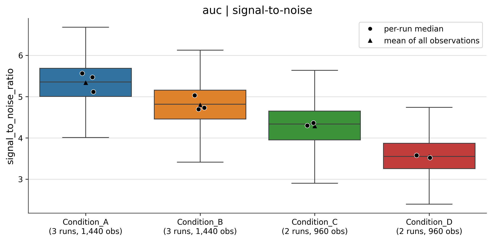
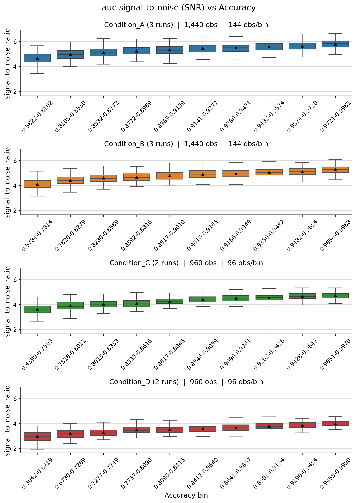
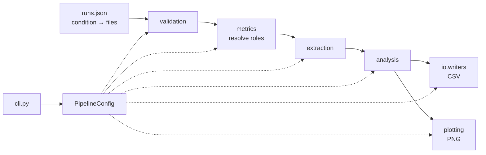

# Data Analytics Pipeline

[](https://github.com/efsxanth/data-analytics-pipeline/actions/workflows/ci.yml)
[](https://www.python.org/)
[](https://pola.rs/)
[](https://docs.astral.sh/ruff/)
[](#groqcloud-interpretation-and-deployment)
[](https://efsxanth.github.io/data-analytics-pipeline/)
[](LICENSE)

A deterministic analytics pipeline that compares repeated experimental runs across 
conditions and identifies **which condition achieved higher performance — and 
how confidently that can be said based on the data**. No external data is 
required to try it: the demo generates synthetic data automatically, runs the 
full analysis, and produces an easy-to-navigate report that brings the findings, 
figures and tables together in one place.

On top of that sits an **AI interpretation layer** for the
[published demo](https://efsxanth.github.io/data-analytics-pipeline/): an LLM on GroqCloud,
called through LangChain with a strict structured-output schema, answers four predefined
research questions from the run's statistics. Every number it cites is verified against the
table cell it names, a wrong citation is sent back with the reason, and the site is only
published when all four answers pass. The answers sit beside the relevant figures, clearly
labelled, with their limitations and automated review flags.

The two layers are deliberately unequal. The analysis is deterministic, reproducible and runs
offline with no API key; the AI prose is interpretation on top of it. A verified citation shows
the model copied a number correctly, not that it reasoned about it correctly, so where the two
disagree, the deterministic findings stand.

Built with **Polars** end to end, thread parallelism for I/O and process parallelism for rendering.

```bash
pip install -e .
da-pipeline-demo          # generates synthetic data and analyses it — no inputs needed
```

---

## Contents

- [Getting started](#getting-started)
- [Sample output](#sample-output)
- [See it without installing anything](#see-it-without-installing-anything)
- [GroqCloud interpretation and deployment](#groqcloud-interpretation-and-deployment)
- [The shape of the data](#the-shape-of-the-data)
- [What it computes](#what-it-computes)
- [Architecture](#architecture)
- [Design decisions worth reading](#design-decisions-worth-reading)
- [Running it on your own data](#running-it-on-your-own-data)
- [CLI reference](#cli-reference)
- [Development](#development)
- [Known follow-ups](#known-follow-ups)
- [References](#references)

---

## Getting started

This project defines its own input format, and ships the reference producer for it. There is no
external file to obtain: the generator writes extracts that satisfy the specification, so a
clone can run the whole pipeline immediately.

```bash
git clone <this repo> && cd data-analytics-pipeline
python -m venv .venv && .venv/Scripts/activate      # or: source .venv/bin/activate
pip install -e ".[dev]"
da-pipeline-demo
```

That writes 10 synthetic extract files across 4 conditions, then runs the real pipeline over
them. Results land in `demo_data/Data_Analytics/`: 33 figures, 19 CSVs, a self-contained
`report.html` and an `ai/` evidence pack; the separate publishing step adds Groq interpretations to the report.

The generator plants a quality gradient (condition A best, D worst) and couples each
observation's signal to its own outcome, so the figures show structure both *between* and
*within* conditions — and the end-to-end test asserts that gradient survives to the output.

Every number quoted in this README comes from that demo run. Nothing here is carried over from
data the repository cannot produce, and `tests/test_quoted_figures.py` recomputes the worked
examples so a stale figure fails the build.

## Sample output

Every figure below was produced by `da-pipeline-demo` from synthetic data.

**One box per condition, groups pooled.** The tick labels carry both counts that matter —
how many runs make up the condition, and how many observations went into the box:



**One panel per condition, x-axis = equal-count bins of the outcome metric.** This is the figure
the binning design exists for; [design note 7](#7-equal-count-bins-assigned-by-rank--and-why-they-are-faceted)
explains why the conditions are not overlaid on a single axis:



## See it without installing anything

The demo output is published at **[efsxanth.github.io/data-analytics-pipeline](https://efsxanth.github.io/data-analytics-pipeline/)**.
On every push to `main`, GitHub Actions runs the demo, adds the four Groq interpretations, and
publishes the self-contained HTML report with its evidence files.

The report is organised around the research questions: Overview, Conditions,
Reproducibility, Relationships, Multivariable model, Tables, and How to read this.
Each question-specific tab preserves the original plots and deterministic findings, followed
by a Groq AI interpretation with numerical citations, caveats and review warnings. The
Overview remains grounded in the deterministic results rather than presenting AI statements as
independently established facts.

### Evidence files for independent review

The demo still produces [`evidence_pack.json`](https://efsxanth.github.io/data-analytics-pipeline/ai/evidence_pack.json)
and [`prompt.md`](https://efsxanth.github.io/data-analytics-pipeline/ai/prompt.md).
The former contains derived statistics without filesystem paths, with run identifiers
pseudonymised where necessary; the latter is a separate, human-readable statistical briefing.
These artifacts remain available for downloading or use with another language model. The
Groq integration uses its own question-specific prompts; it does **not** feed the pipeline's
existing deterministic finding answers to the model.

## GroqCloud interpretation and deployment

The publishing job uses **LangChain** and `langchain-groq` with the GroqCloud model
`openai/gpt-oss-120b` (the code's default is `openai/gpt-oss-20b`; the workflow selects the
larger model because it copies cited values more reliably, under the same free-tier limits).
Pydantic defines the strict structured response, including the question
identifier, interpretation, numerical evidence references and caveats. The deterministic validator
checks the question, permitted table paths, row indices and quoted numerical values against the
original evidence (absolute tolerance `1e-6`). An answer that fails is asked again with the
validator's reason. Additional scientific-review heuristics flag selected potentially
unsupported claims, but cannot certify the narrative: a correctly copied number can still be
misread, so where an interpretation and the deterministic findings disagree, the findings win.

The four required questions are:

1. **Which conditions differ, on what, and how confidently?** — effect sizes and adjusted pairwise comparisons.
2. **Would these differences reproduce?** — variance decomposition and run-to-run spread.
3. **What relates to the outcome metric, and does it hold inside a run?** — pooled, within-run and between-run correlations.
4. **What does the multivariable model add?** — coefficients, diagnostics and held-out-run performance.

The orchestration layer in `src/da_pipeline/llm/orchestrator.py` evaluates all four questions
and records failures independently. **The publishing step is stricter:**
`scripts/build_ai_report.py` requires a successful, numerically validated interpretation for
every question before rewriting `report.html`. The GitHub Pages job runs that script before
uploading the site. If a required Groq request or validation fails, the deployment stops and
the previously published site is left in place. Scientific-review flags accompany a successful
answer rather than automatically blocking publication.

Only the **publishing job** calls GroqCloud; ordinary lint, tests and demo generation do not
require a secret. To configure publishing, create a GitHub Actions repository secret named
`GROQ_API_KEY` under **Settings → Secrets and variables → Actions**. Never commit `.env` or put
an API key into the README or workflow. The publishing job receives the key through its
environment. GitHub Pages must be configured to deploy from **GitHub Actions**.

For a local dry run *after generating the demo*, use:

```powershell
python scripts/build_ai_report.py --check-input
```

This checks that the existing report and evidence are available, but makes **no** Groq requests
and does not modify the report. To generate all four AI interpretations locally, configure
`GROQ_API_KEY` in your ignored `.env` file, then run:

```powershell
python scripts/build_ai_report.py
```

That command makes live API requests and may incur rate-limit or token costs. The demo still
works offline via `da-pipeline-demo`; **Groq is mandatory for publication of the enhanced
website**, not for the underlying numerical analysis. The build is designed to fail rather than
silently publish an incomplete AI report.

### Staying inside the free tier

On GroqCloud's free tier both gpt-oss models allow 8,000 tokens per minute, and a single
request's prompt **plus** its `max_tokens` must fit inside that. Several choices keep the four
requests within it:

- **Compact evidence.** Tables are sent as columns and rows rather than repeated key names; a
  column with the same value in every row is written once under `constants`; each row starts
  with its own `row_index`, so the model copies an index instead of counting rows.
  `--check-input` prints every question's approximate prompt size, so the budget can be checked
  offline.
- **Low reasoning effort.** gpt-oss reasons before it answers, and that reasoning is drawn from
  the same `max_tokens` budget as the JSON. `low` leaves room for a complete answer.
- **Pacing.** Requests are spaced 75 seconds apart so one minute's budget has cleared before the
  next.
- **Corrective retries only.** A wrong citation, a disallowed table or malformed JSON is asked
  again with the reason. A request rejected for size or rate is not retried, because repeating
  it cannot help. When a request fails, the log shows Groq's HTTP status, error code and
  message, never the generated text.

Every setting is an environment variable, read from `.env` locally and from the workflow in CI:

| Variable | Default | Purpose |
|---|---|---|
| `GROQ_API_KEY` | *required* | GroqCloud key; a repository secret in CI |
| `GROQ_MODEL_NAME` | `openai/gpt-oss-20b` | The publishing workflow sets `openai/gpt-oss-120b` |
| `GROQ_REASONING_EFFORT` | `low` for gpt-oss | `low`, `medium` or `high`; empty to send none |
| `GROQ_MAX_TOKENS` | `2048` | Output budget per request; Question 1 uses 1,500 because its evidence is larger |
| `GROQ_TEMPERATURE` | `0.0` | |
| `GROQ_MAX_RETRIES` | `3` | Client retries for transient errors such as rate limits |
| `GROQ_REQUEST_GAP_SECONDS` | `75` | Pause between requests |
| `GROQ_MAX_ATTEMPTS` | `2` | Attempts per question; the publishing workflow sets `3` |

## The shape of the data

The pipeline analyses **repeated-measurement runs**: many things are measured in parallel, step
by step, against a known reference. Nothing about the analysis assumes a particular subject
matter — the vocabulary below describes the structure of the experiment, and that structure is
all the code knows.

| Term | What it means here |
|---|---|
| **Group** | A known reference case. The same panel of groups is measured in every run, so they are the controlled variable. |
| **Observation** | One measurement site, measuring one group. A run has thousands. Observations are the unit of measurement — every per-observation metric is one row. |
| **Step** | One measurement stage, applied across every observation at once. A run proceeds step by step. |
| **Level** | How much response the reference expects at one step: level 0 means "nothing expected", level 1 one unit, and so on. |
| **Reference levels** | The expected level at every step of a given group — the ground truth the outcome metric is scored against. Every file must state the same one. |
| **Response** (e.g. `auc`) | The raw measured signal per observation per step, before anything is derived from it. |
| **Signal-to-noise (SNR)** | Per observation, the median response at one reference level divided by the median at another. "How far is a real response from nothing?" Which two levels is configuration. |
| **Metric** | Any per-observation quantity a file declares. The set is **not fixed by the pipeline** — see [design note 0](#0-the-metric-set-is-data-not-code). |
| **Condition** | An experimental group — a setting, a protocol, a formulation. Each condition is one or more runs. Comparing conditions is the point. |

## What it computes

| Stage | Output |
|---|---|
| **Observation counts** | Observations per group per condition — totals and medians. |
| **Responses by level** | Raw signal distributions split by level 0 / level 1 / level 2. |
| **Effect size** | Eta-squared with a bootstrap confidence interval and a one-way ANOVA p, per level — computed on **per-run medians**, and on the raw response only. |
| **Pairwise conditions** | Which conditions differ, by how much and in which direction: CLES with a bootstrap interval plus a Mann-Whitney p, Benjamini-Hochberg corrected within each metric, on every metric. |
| **Signal-to-noise** | Per-observation SNR, pooled per condition. |
| **Predictor metrics** | The distribution of each metric the run treats as a predictor. |
| **Outcome metrics** | The outcome metric plus each of its components. |
| **Correlations** | Pearson and Spearman for every pair of per-observation metrics, with pairwise deletion — in three views: pooled across a condition's observations, computed **within each run** then summarised across runs, and computed **between the run medians** themselves. |
| **Outcome model** | Multivariable OLS of the outcome on SNR and every predictor metric — fitted **inside each run**, standardised within run, with per-run VIF, bootstrap intervals over runs and leave-one-run-out cross-validation. |
| **Variance decomposition** | Each metric's spread split into condition / run-within-condition / observation-within-run, so a condition effect can be read against the run-to-run spread beside it. |
| **Run spread by condition** | Per condition and metric: the range and IQR of its run medians, and how far the result moves if the single most influential run is dropped — the numeric form of "is this carried by one run?". |
| **Bin summaries** | Every metric summarised against equal-count bins of the outcome: quantiles, spreads, quantile skew and kurtosis. |

Output tree:

```
Data_Analytics[_<suffix>]/
├── report.html                       # deterministic locally; enriched by Groq in Pages publishing
├── ai/
│   ├── evidence_pack.json            # every derived statistic
│   ├── prompt.md                     # the briefing that goes with the pack
│   └── run_id_mapping.json           # local only; written when ids were pseudonymised
├── data_analytics_process.log        # the run's settings and progress
├── observation_counts/  responses/  signal_to_noise/
├── predictor_metrics/  outcome_metrics/
├── relationships/                    # metric vs outcome bins, faceted by condition
├── correlations/                     # the three views, and where they disagree
├── effect_size/  variance_decomposition/  outcome_model/
└── csv_exports/
    ├── <dataset>.csv
    ├── effect_size.csv                 # always written; carries the unit of analysis
    ├── variance_decomposition.csv      # always written
    ├── run_spread_by_condition.csv     # always written
    ├── pairwise_conditions.csv         # which conditions differ, every metric
    ├── outcome_model.csv               # one row per predictor + the cross-validated fit
    ├── outcome_model_by_run.csv        # the per-run fits behind that summary
    ├── correlations/correlations.csv
    ├── correlations/correlations_within_run.csv
    ├── correlations/correlations_between_run.csv
    └── bin_summaries/<metric>_and_<outcome>_bin_summary.csv
```

Directory names describe a *role* and stay fixed, so a reader always knows where to look. File
names that describe a particular metric are built from the run's own metric names: with
`--outcome_metric yield`, that last line reads `degradation_1_and_yield_bin_summary.csv`.

## Architecture



```
src/da_pipeline/
├── config.py           PipelineConfig — the run description, validated at construction
├── cli.py              argv → PipelineConfig. Parsing only; no rules of its own
├── metrics.py          which discovered metric plays which part in this run
├── pipeline.py         orchestration: the order the stages run in
├── validation.py       cross-file agreement checks — the pipeline's safety property
├── extraction.py       extracts → per-observation dataframes (thread pool over files)
├── frames.py           small Polars and label helpers
├── synthetic.py        the reference producer for the format (demo + test fixtures)
├── demo.py             `da-pipeline-demo`
├── llm/                research questions, prompts, Groq adapter, validation, scientific review, orchestration
├── reporting/          deterministic findings, evidence pack, and AI-enhanced HTML report
├── constants/
│   ├── columns.py      names of columns we create
│   ├── schema.py       the extract-file format — this project's own specification
│   ├── outputs.py      directory and file names a run writes
│   └── display.py      words and proportions that appear in figures
├── io/
│   ├── extract_reader.py   the only module that knows HDF5
│   ├── run_config.py       loads the JSON config (Windows paths, duplicate keys)
│   ├── paths.py            where results go; logging setup
│   └── writers.py          CSV export
├── analysis/           binning, bin_summaries, correlations, effect_size,
│                       variance, run_spread, pairwise, model, inference
└── plotting/
    ├── figures.py      theme, geometry, the create/save/close lifecycle
    └── plots.py        what each figure shows
```

The dependency direction is one-way: `analysis/` takes dataframes and returns dataframes with
no file access and no plotting, which is what makes it testable without a disk.

## Design decisions worth reading

### 0. The metric set is data, not code

An extract declares its own metrics. `/observations/metrics` is one `(n, m)` matrix with a
`metric_names` attribute naming its columns, so a producer may write any number of metrics under
any names, and the pipeline discovers them on read. **No metric name appears anywhere in the
analysis layer**, and `constants/columns.py` deliberately declares no symbol for the outcome
column — which metric that is, is configuration, and a constant would be a second place for the
name to live.

What the analysis does need is to know which metric plays which part, because the three roles
are not interchangeable:

- **outcome** — the metric the run is organised around. It defines the equal-count bins every
  other metric is summarised against, and it is what the model predicts. Exactly one.
- **component of the outcome** — another description of the same result. Reported beside the
  outcome, never used to predict it: regressing the outcome on a restatement of itself would
  mostly recover the arithmetic relating the two.
- **predictor** — an independent per-observation quantity. These are what the correlations and
  the model are about.

By default the roles are derived from the discovered names by one convention the format states:
a metric called `<outcome>_<something>` is a component of that outcome, and everything else is a
predictor. Any of the three can be named explicitly instead. The whole resolution is one
function, `metrics.resolve_metric_roles`, and it runs once per run.

**Discovery is permissive; selection is strict**, and the distinction is load-bearing. The
pipeline accepts whatever metric set the files declare — a metric it was not told about is
simply not analysed. But a metric the run *names* and the files do not declare stops the run,
with a message listing everything they did declare:

```
MetricSelectionError: metric_names: degradaton_1 is not declared by the extract files.
Declared: Accuracy, Accuracy_error_1, ..., degradation_3.
```

A typo would otherwise mean the analysis somebody asked for silently did not happen, and a run
that looks like a success while missing the thing under investigation is worse than one that
stops.

### 1. The config is the contract, and the CLI is a thin adapter

Every setting for a run lives in one frozen `PipelineConfig`, and **all configuration validation
happens in its `__post_init__`** — not in the argument parser. A config built in a notebook or a
test is checked exactly as strictly as one built from `sys.argv`:

```python
PipelineConfig(config_path=Path("runs.json"), response_name="auc", step_range=StepRange(4, 2))
# ConfigError: step_range: start (4) must not exceed stop (2).
```

`cli.py` catches `ConfigError` and re-raises it through `parser.error`, so the user still sees a
usage message rather than a traceback — but there is no rule the CLI enforces that the library
does not.

One kind of check cannot live there. Whether a *metric* exists is a question about the files, and
at construction none has been opened — so the metric selection is checked for internal coherence
in the config and resolved against the files at the start of the run. That is also why no metric
argument carries an argparse `choices` list: the valid values are not known until a file is read.

The config is frozen because it is read from worker processes: nothing should be able to change
the step range halfway through a run and leave two figures describing different windows of the
same data. Frozen dataclasses only stop attribute rebinding, so the one dict a config holds is
wrapped in a write-refusing `MappingProxy` — which implements `__reduce__`, because the default
dict-subclass pickle path replays contents through the `__setitem__` it blocks, and the plotting
layer pickles the config to send it to workers.

### 2. The run is the unit of analysis, and the figures say so

A condition may contain one or more runs, each contributing thousands of observations. Where
there are multiple runs, the observations within a run are **not** independent replicates — they
share the same equipment, the same setup, the same day — so a statistic computed over pooled
observations is answering a question about a handful of runs while claiming the precision of
thousands of measurements.

The demo dataset shows the size of the gap. `Condition_A` and `Condition_B` differ in median
`Accuracy` by 0.013. Pooling their 2,880 observations returns `p = 1.9e-08`. The same comparison
on the six run medians that produced them returns `p = 0.2`.

So inferential comparisons meant to support a claim about a *condition* are computed
on one value per run:

- **Eta-squared** aggregates each run to a median first, which makes the
  accompanying one-way ANOVA legitimate. It is kept to the raw extracted response
  by preference rather than necessity — [design note 3](#3-association-is-reported-mechanism-is-a-separate-question).
- **Correlations** are computed *inside* each run and then summarised across runs
  as a median, a range, and how many runs agree on the sign. Pooling mixes how
  observations covary within a run with how run averages covary across runs, which
  is enough to reverse a coefficient's sign. A single pooled
  coefficient answers three questions at once and reports one number for all of
  them, so all three are written separately: **pooled** (true of the observation
  population measured, not evidence), **within-run** (the reproducibility claim
  the design supports), and **between-run** (do the runs that came out better on
  one metric come out better on the other — the only view whose unit really is
  the run, and confounded with condition, which is stated rather than tested
  away).

  The figures under `correlations/` exist because the disagreement between the
  first two is the finding, and no single table shows it. A scatter puts every
  pair's pooled coefficient against its within-run one: the diagonal is
  "pooling did not distort this", and on the demo data **17 of 180 pairs
  land with opposite signs**. Then one figure per condition lists every pair
  with both values joined by a line, ordered by how far apart they landed, so
  the ones to distrust the pooled table for come first. Widest gap on the demo
  data: `degradation_2` against `degradation_3` in `Condition_A` reads
  **+0.125 pooled and −0.035 within-run** — a visible relationship, and nothing
  at all.
- **Every per-condition boxplot carries one dot per run** — a [SuperPlot][superplot].
  The box describes the observations; the dots are what a comparison actually rests on.
  It makes a difference driven by a single outlying run visible instead of hidden
  inside a narrow box.

[superplot]: https://doi.org/10.1083/jcb.202001064

The unit is stated on the figure, in the log line, and as a `unit_of_analysis`
column in the CSV — a run-level and an observation-level eta-squared look identical on a
bar chart and mean very different things.

#### Why pooling manufactures relationships

Two runs of the same condition. Inside each one, the two metrics are drawn
**independently** — there is no relationship to find. The only difference between
the runs is their overall level: run 2 simply went better, so it sits higher on
*both* measures.

```
  metric b
    6.5 |                                          2  222 2
    5.5 |                                       2 2222222222 22
    4.5 |                                         222222222 22
    3.5 |
    2.5 |
    1.5 |
    0.5 |          1 111111 1
   -0.5 |       11 11111111111111 1
   -1.5 |          1 11111 1
        +-------------------------------------------------
        -1.5                                        6.5   metric a

  1 = run 1 observations,  2 = run 2 observations

  within run 1:  r = -0.036        (n = 300)
  within run 2:  r = +0.019        (n = 300)
  pooled:        r = +0.966        (n = 600)
```

Each cloud on its own is round. The two clouds sit on a diagonal. The pooled
`+0.966` is a true statement about *two runs* — the better run was better on both
measures — presented as though it were a statement about 600 observations.

Pooling does not only inflate: it mixes within-run covariation with between-run
covariation, so the pooled coefficient can be larger, smaller, or **opposite in
sign**. On the demo data, `Condition_A` gives signal-to-noise against
`degradation_2` as −0.107 pooled and +0.018 within-run. The effect is pinned by
`test_pooling_invents_a_relationship_that_within_run_does_not_see`.

#### What this does and does not change

Treating the run as the unit matters for relationships and for evidence. It does
not make the descriptive outputs wrong:

| Affected | Not affected |
|---|---|
| Correlations and regression coefficients | Medians, quantiles and IQRs of a single variable |
| Any p-value, confidence interval or standard error | Boxplots and distribution shapes |
| Anything treating *n* as evidence | Bin summaries and descriptive tables |

A pooled median of SNR is a perfectly good description of the observations that were
measured. What breaks is (a) **relationships between two variables**, because
pooling blends two sources of covariation, and (b) **any claim of statistical
evidence**, because 600 correlated observations are not 600 independent ones —
they are two runs.

A **variance decomposition** then makes the trade-off explicit, splitting each
metric's total sum of squares into the three nested layers of the design
(`SS_total = SS_condition + SS_run + SS_observation`, an exact identity). The number
that matters is the ratio of the middle layer to the first: condition-associated
variation no larger than the run-to-run spread around it has weak support, however
many observations were measured. On the demo data the decomposition separates the
response levels sharply — at level 1 and level 2 the condition accounts for about
92% of the spread, while at level 0 it accounts for 3.5%, which is the level where
the reference expects nothing and there is correspondingly little for a condition to
change. Being a decomposition of the data observed rather than an estimate of
variance components, it reports weak evidence — it does not forecast a future run.

That decomposition is global, so a **per-condition run spread** table sits beside
it, reporting each condition's own run medians — range, IQR, and how far the
result moves if the single most influential run is dropped, together with which
run that was. It is the numeric form of the dots on the boxplots, and it answers
the question a reader actually asks of a difference: *is this consistent across
the runs, or carried by one?*

The influence shift is measured on the **mean** of the run medians, not the
median, for a reason worth stating: the median is deliberately robust, so with
runs at 9.9, 10.0, 10.1 and 40.0, dropping *any* of them moves the median by the
same 0.05 — a leave-one-out on the median cannot tell an extreme outlier from an
ordinary run. The mean is also what eta-squared and the ANOVA compare, so
influence on the mean is influence on the result being reported.

### 3. Association is reported; mechanism is a separate question

Every condition statistic here is an **association**: these conditions differ on
this metric. None of them supports "the condition raised the outcome by improving
signal-to-noise" — that is a mechanistic claim, and it is what the relationship
analyses are for (the outcome bin plots, the cross-metric correlations and
the multivariable model).

An earlier version **suppressed** the condition share for the more derived
metrics, the outcome among them, on the grounds that they arrive after several
processing steps. Every condition is processed identically, so the same fixed
transformation reaches all of them and a difference can still be associated
with the condition — and the outcome is what the work exists to improve,
which makes "does it differ between conditions?" one of the most important
questions to ask, not one to hide.

So every metric reports its comparison, and the qualification lives here, in
prose that can explain it, rather than in a per-row label. Suppression removes
information a reader needs; a one-word column cannot carry the reasoning that
makes the number safe to read anyway.

The one deliberate asymmetry: the omnibus eta-squared is still computed on the
extracted response alone. This is a reporting choice rather than a statistical
necessity: "variance explained by condition" is the most attribution-flavoured
phrasing in the output, while the pairwise comparisons answer the practical
question — *which* conditions differ, by how much, in which direction —
considerably better.

### 4. Not every real difference is a significant one, and vice versa

The pairwise output always carries the effect size beside the p-value, because at
these replicate counts the two come apart in both directions. Three runs against three
can separate completely — CLES of 1.0, every pairing won — and still return
p = 0.1, because 0.1 is the smallest two-sided p attainable at that size. (At four
against four the floor is 0.029.) A bare p would call that nothing; a bare CLES
would call it certain.

Splitting one question into every pair of conditions runs several tests at once, so
the p-values are adjusted by [Benjamini–Hochberg][bh] — chosen over Bonferroni
because these comparisons are exploratory, and controlling the expected *proportion*
of significant findings that are false is the guarantee that matters here rather than
the chance of any false finding at all. The family is **one metric**, not the whole
table: metrics are separate questions, and pooling them would make an answer about
one metric depend on how many other columns happened to be extracted. Both the method
and the family are written into every row, as `p_adjust_method` and `p_adjust_family`.

Every interval is a percentile bootstrap that **resamples runs**, under a fixed
seed — and the seed has to fix the answer, not the answer-given-this-row-order.
It did not, at first: the generator emits one fixed sequence of index positions,
and applying it to the same run medians in a different order draws different
resamples. CLES and Mann-Whitney are order-invariant, so nothing warned that the
*interval* was not, and `group_by` promises no order. Two runs of the same data
returned CLES upper bounds of 0.60 and 0.54 for the same comparison. The
bootstrap now sorts its inputs, which changes no estimate — every statistic it
resamples is order-invariant — and makes the reproducibility claim true. Pinned
by `TestTheSeedFixesTheInterval`.

**No p-values accompany the pooled correlations**, deliberately. A p-value asks
how surprising a coefficient is given *n independent observations*; pooling
observations from several runs makes that n thousands of repeated
measurements, and every pair comes out overwhelmingly significant regardless of
the truth. The coefficients stay — the r of 0.620 between signal-to-noise and
`Accuracy` in `Condition_A` honestly describes the 1,440 observations measured —
but the reproducibility claim is made by the within-run table's
"how many runs agreed on the sign", which the replicate count actually supports.

[bh]: https://doi.org/10.1111/j.2517-6161.1995.tb02031.x

### 5. One predictor at a time cannot separate predictors that move together

The correlation tables ask about SNR and the outcome, then one degradation metric
and the outcome, then SNR and that metric — and cannot tell whether the first two
relationships are two findings or one seen twice. A **multivariable model** carrying
every predictor at once reports what each still contributes with the others held
constant.

It inherits the whole design from note 2: **one fit per run**, predictors *and*
outcome standardised within that run, coefficients summarised across runs with a
bootstrap interval that resamples runs. Three consequences follow, each of which
is the reason for a column in the output:

- **Standardising the outcome too removes the intercept.** Both sides are
  centred, so it is zero by construction. That is what makes a coefficient
  vector from one run applicable to another — runs sit at different absolute
  levels of the outcome and of every predictor, and without a common scale there
  is nothing to transfer.
- **Condition is not a predictor, and this is not a modelling choice.** Condition
  is constant within a run, so a per-run design matrix carrying it is singular.
  "Does the condition change the outcome?" is a different question, answered on
  run medians by the pairwise comparisons.
- **VIF is reported, not acted on.** A predictor overlapping heavily with the
  others still gets an unbiased coefficient — just a much less stable one. That
  is a fact the reader needs, not grounds for the pipeline to silently drop a
  variable.

#### Sign agreement is consistency; a held-out run is evidence

"Positive in every run" is a strong-sounding statement that does not say what
it appears to. It measures whether the runs agree with each other, not whether
the relationship predicts a run the model never saw — and with correlated
predictors those two come apart. So each run is also **held out in turn**: the
model is fitted on the others, the median coefficient vector is applied to the
held-out run, and the R² is reported.

The median vector across training runs is used rather than a refit on their
pooled rows, because pooling would reintroduce exactly the between-run
covariation the design exists to keep out.

A negative out-of-sample R² is not a failure of the code — it is the finding.
It means the coefficients predicted that run worse than its own mean would have,
which is the honest baseline for a within-run model. The test
`test_consistent_signs_do_not_by_themselves_mean_it_transfers` builds precisely
this case: four runs, all agreeing on sign, one of which the others cannot
predict.

#### Plain OLS on the raw value

An outcome that is a bounded proportion normally argues for a logit or binomial
model. Neither is used, for two reasons.

The format carries every metric as a bare float with no numerator or denominator,
so a **binomial GLM is not available** at all: there is no count to model.

And the objections to OLS here are weaker than they look, because **the
inference does not come from the regression**. Non-constant residual variance
near the bounds distorts OLS standard errors and p-values; none are reported. The
intervals come from resampling runs. Each per-run fit is a descriptive summary of
within-run association, the run-level bootstrap does the inferential work, and a
transform would cost interpretability to fix an assumption nothing depends on.

Two things are left out on purpose. The outcome's **component metrics** are not
predictors but alternative descriptions of the same outcome;
regressing the outcome on them would largely recover the arithmetic relating them to
it, and their relationship to the outcome is already covered by the correlations and
the bin summaries. And where a run contains several **groups**, their observations are
fitted together — groups sit at different absolute levels, so a small amount of
the same between-group covariation this design removes at run level survives at
group level.

### 6. The output explains how to read itself

Nineteen CSVs and thirty-odd figures are the right output for someone who
already knows the project and the wrong one for everybody else. The findings are
real, but they are spread across files, and the several rules for reading them
honestly are not written anywhere near the numbers.

So every run also writes `report.html` — one self-contained file, every figure
embedded as a data URI, no external request of any kind. It can be emailed or
dropped in a shared folder and still render exactly as it did on the machine
that made it; a report that only works beside its own directory is a report that
arrives broken.

The enhanced report uses **seven tabs** following the questions rather than the file
system — Overview, Conditions, Reproducibility, Relationships, Multivariable model,
Tables, How to read this — so a reader lands on a summary rather than on thirty-odd figures.
Each tab leads with the findings it is about and then shows the figures
supporting them, because a figure in a gallery at the end of a document is a
figure nobody connects to anything. A tab whose content a run did not produce is
dropped rather than opening onto nothing.

The tabs are **CSS only** — hidden radio inputs and labels, no script — which is
what keeps the page inert enough to render in locked-down viewers and anywhere a
script would be stripped. The radios are clipped rather than `display: none`, so
they stay keyboard-reachable. Tabs cost two things and one is bought back:
find-in-page only searches the open tab, which is inherent to hiding content, but
a print stylesheet reveals every panel, so `Ctrl+P` or save-as-PDF gives the
whole report as one continuous document whatever tab is showing.

The **deterministic findings** are computed from the frames, not written by hand.
The separately labelled Groq interpretations are generated from selected evidence,
with numerical-reference validation and scientific-review warnings; their prose
is not guaranteed correct. Two deterministic phrasings are enforced by tests:

- a comparison that did not reach significance is reported as **not separated**,
  never as "the same" or "indistinguishable";
- every condition result is phrased as a difference **associated with** the
  condition, never as the condition having caused it.

#### The same content, shaped for a model

`ai/evidence_pack.json` carries the derived statistics — no filesystem path, no
configuration, no per-observation row. Run identifiers that carry an organisation's
internal naming are pseudonymised (`machine4_20240115b` → `run_08`), with the
mapping written to a separate local file, because the pack is the thing most
likely to be pasted somewhere else. Where the runs are already named `run_01`,
`run_02`, … there is nothing to hide and nothing to decode, so they are used
unchanged and **no mapping file is written** — an identity mapping tells a
reader nothing while still looking like a secret. Condition names are kept
either way: an interpretation that comes back discussing `condition_2` has to be
decoded by hand before it is any use. The Pages publishing job deletes any local run-ID mapping before uploading, so
what ships is the pack without the file that undoes it.

Beside it, `ai/prompt.md` is the part that matters. A model handed a table of
coefficients and p-values will do the obvious, confident, wrong thing with it —
report that two conditions are equivalent because a p-value was large, read a
pooled correlation as evidence, or suggest adding the condition as a predictor
to a model that cannot contain it. Every one of those was done by a capable
reader during this project's development, more than once. They are not careless;
they are what the numbers look like they mean. The only reliable fix is to state
the rules in advance, next to the data, which is what the briefing does.

Because the metric set is discovered rather than fixed, the briefing's metric table
is **generated from the run's resolved roles**. A briefing that named metrics the
data does not contain would be worse than one that named none, and it tells the
model explicitly not to assume any metric it has not been shown.

Two engineering notes fell out of building it. The bin summaries are stored one
CSV per metric, each repeating the same bin and outcome columns — right
for a file a person opens alone, and two thirds of an early pack. They are
rejoined into the frame they were split from, losing nothing. And the findings
are written from the in-memory frames *before* pseudonymisation, since the
report is local and should name a run you can go and look at — so the pack
substitutes identifiers in prose as well as in columns, longest first, or
`run-1` rewrites the front of `run-13`.

### 7. Equal-count bins, assigned by rank — and why they are faceted

The outcome metric is divided into equal-count bins **within each condition** (10 by default), by
sorted rank rather than by value threshold. An outcome is often highly discrete and heavily tied
near the top, so a value-threshold cut would produce wildly uneven bins; ranking guarantees every
bin holds the same number of observations ±1, at the cost of occasionally splitting identical
values across adjacent bins.

That cost has a consequence the code takes seriously: two adjacent bins can end up with the
*same* human-readable range label. So binning emits **two** columns — an integer
`outcome_bin_index` that is the canonical ordered identity used for every group, join and
sort, and a display-only `outcome_bin` range string that is never a key.

Because edges are derived per condition, bin 4 spans a different range in each
condition. Overlaying conditions on one categorical axis would therefore put unlike things at
the same x position, so each condition gets **its own panel** with its own tick labels, sharing
the y-axis — which is the comparison that is actually valid.

Everything the bins are *labelled* with follows the configured outcome: the axis reads
`Accuracy bin` by default and `yield bin` under `--outcome_metric yield`, and the CSV file names
carry the same word. A fixed string there would have been the last place the output still assumed
which metric the outcome was.

### 8. Row identity is carried, not assumed

Extraction never aligns frames by row position. Every per-observation frame carries
`(run_id, condition, group_id, observation_id)`, and downstream stages join on it. Where a file's
id and group arrays must be co-indexed, `_check_co_indexed` asserts it explicitly rather than
letting a length mismatch misalign silently.

The plotting layer then checks the same property from the other end: equal-count binning means
every bin should hold the same number of points ±1, so a wider spread proves an upstream join
dropped rows, and `_warn_on_uneven_bins` says so in the log.

### 9. Figure style travels with the figure

Figures are rendered in a `ProcessPoolExecutor`. A matplotlib style applied once at the entry
point would not survive: under `spawn` (which Windows uses) child processes do not re-run the
`__main__` guard. So there is no `set_style()`. The theme is applied inside a `plt.rc_context`
that spans figure creation *through saving* — `savefig` reads rcParams at save time, so styling
only creation would lose half of it — and the whole lifecycle is one context manager that closes
the figure even if the body raises. At 300 dpi a leaked figure is several megabytes.

DPI deliberately lives in a per-run `FigureConfig` rather than in the theme: as an rcParam it
would silently apply to every figure in the process, including ones this pipeline did not create.

### 10. Colour is data

`condition → colour` is built once, up front, keyed by name, and validated for duplicates and
palette exhaustion before any figure is drawn. A condition therefore cannot be blue in one
figure and orange in another, and a missing entry fails immediately rather than rendering in
some arbitrary default several figures later.

### 11. Failures are isolated, memory is not held

Both the extraction thread pool and the plotting process pool catch per-item exceptions, log
them, and continue — one unreadable file or one bad figure cannot abort a run that takes
minutes. Extraction additionally verifies that every worker's frame has an identical schema
before concatenating, so a silent dtype drift becomes an error instead of a corrupted column.

The orchestrator deletes each large frame immediately after its last consumer. On a full dataset
the per-observation frames are the biggest objects in the process, and holding one a stage longer
is paid for once per forked worker.

### 12. Counts are named by their unit

A bare "N" is ambiguous when two different counts appear on the same figure, so the vocabulary
is fixed: **runs** are the files making up a condition, **obs** are the rows that went into the
box. They appear together as `Condition_A / (3 runs, 1,440 obs)`. Counts never leak into the
data — the `condition` column keeps clean names and the counts live only in the display labels.

## Running it on your own data

Write a JSON file mapping each condition to its extract files. Windows paths may use single or
escaped backslashes; duplicate keys, empty lists and newlines in names are rejected:

```json
{
    "Condition_A": [
        "C:\\data\\runs\\A\\run_01.h5",
        "C:\\data\\runs\\A\\run_02.h5"
    ],
    "Condition_B": [
        "C:\\data\\runs\\B\\run_03.h5"
    ]
}
```

The **key order is the condition order** in every figure, and results are written **beside the
config file** — so the config lives with the data, and analysis output never lands in the repo.

```bash
da-pipeline --data_analytics_config_fpath C:\data\runs.json --response_name auc
da-pipeline --data_analytics_config_fpath C:\data\runs.json --response_name auc \
            --group_ids 3 --output_folder_name_suffix experiment1
```

Or from Python:

```python
from pathlib import Path
from da_pipeline import MetricSelection, PipelineConfig, run

output_dir = run(PipelineConfig(
    config_path=Path("runs.json"),
    response_name="auc",
    group_ids=[3],
    outcome_num_bins=5,
    metrics=MetricSelection(outcome="Accuracy"),
))
```

`run()` does not configure logging — only the CLI entry point does, because a library call has
no business reconfiguring its caller's root logger.

### The extract-file format

This project defines the format; `synthetic.py` is its reference producer, and
`constants/schema.py` is the specification. There is no upstream owner to conform to.

```
/                          attrs: schema_version, run_id, response_name, created_utc
/observations/id           (n,)                    int
/observations/group_id     (n,)                    int    co-indexed with id
/observations/metrics      (n, m)                  float
                           attr: metric_names (m,) str
/signal/<response_name>    (n, n_steps)            float
/reference/levels          (n_groups, n_steps)     int
/reference/group_id        (n_groups,)             int
```

`schema_version` is written into every file and **checked on every read**. A file that predates
the attribute, or carries a version this build does not know, is rejected with a message naming
both — guessing at an unknown layout is how a rename becomes a silently wrong column.

The metric set is carried entirely by the `metric_names` attribute: any number of metrics, under
any names. Groups have no labels in the format — a display name is a presentation question the
data has no opinion about, so each group is labelled from its own id and `--group_labels` can
replace them.

Extracts may carry additional datasets; anything not listed above is simply not read.

Group IDs, reference levels and the declared metric set must be **identical across every file
listed**. Pooling observations from files that disagree would produce numbers that look fine and
mean nothing, so the run stops rather than warns.

## CLI reference

| Flag | Default | Purpose |
|---|---|---|
| `--data_analytics_config_fpath` | *required* | JSON config mapping conditions to extract files |
| `--response_name` | *required* | Response carried by the extracts, e.g. `auc` |
| `--step_range FROM TO` | `1 17` | Step window, 1-based and inclusive |
| `--group_ids` | all | Restrict the analysis to these groups |
| `--group_labels` | `group_<id>` | Replacement labels, matched to `--group_ids` by position |
| `--metric_names` | all declared | Which of the declared metrics to analyse |
| `--outcome_metric` | `Accuracy` | The metric the run is organised around |
| `--predictor_metric_names` | derived | Override the derived predictor list |
| `--component_metric_names` | derived | Override the derived component list |
| `--metric_labels METRIC=LABEL` | metric names | Display labels in figures and the report |
| `--snr_baseline_level` / `--snr_comparison_level` | `0` / `1` | The two reference levels the SNR is built from |
| `--outcome_num_bins` | `10` | Equal-count bins of the outcome metric, per condition |
| `--calculate_effect_size` | `True` | Compute eta-squared across conditions |
| `--max_workers` | `6` | Worker threads and figure processes |
| `--output_folder_name_suffix` | — | Keeps several analyses of one config side by side |
| `--save_signal_to_noise_ratios_csv` | `True` | |
| `--save_correlations_csv` | `True` | |
| `--save_observation_counts_csv` etc. | `False` | The large per-observation frames are opt-in |
| `--colours` | theme cycle | One colour per condition, hex or matplotlib name |
| `--dpi` / `--figure_width` / `--figure_height` | `300` / `9` / `4.5` | |
| `--signal_to_noise_yaxis_range MIN MAX` | auto | |
| `--predictor_metric_yaxis_range MIN MAX` | auto | |
| `--response_level_yaxis_ranges LEVEL:MIN,MAX` | auto | e.g. `0:0,2 1:0,8` |
| `--boxplot_show_means` / `--show_outliers` | `True` / `False` | |
| `--show_condition_N_in_labels` | `True` | Append `(3 runs)` to condition labels |
| `--xtick_label_rotation` | `45` | |

`da-pipeline --help` prints the full list; `python -m da_pipeline` is equivalent to the command.

`da-pipeline-demo` takes `--observations_per_group`, `--n_degradation_metrics` (any number; three
by default), `--seed`, `--output_dir` and `--generate_only`.

## Development

```bash
pip install -e ".[dev]"

pytest                        # full suite, including offline LLM tests
pytest -m "not slow"          # faster suite without slow end-to-end cases
pytest --cov=da_pipeline      # current coverage report
ruff check src tests
```

The suite runs under `filterwarnings = ["error"]`, so a dependency's deprecation warning fails
the build rather than scrolling past. The Polars floor is `1.36` because that is where
`explode(empty_as_null=...)` arrives, and the pipeline states that argument rather than
inheriting a default Polars 2.0 will flip; `1.35` is verified to fail and `1.36` to pass.
`pyarrow` is declared even though no module imports it — Seaborn needs it to read a Polars
frame, and without it every figure fails on an otherwise complete install.

The suite runs against **real HDF5 files** written by `synthetic.py` rather than mocks of the
reader — the reader is thin and the format is the thing most likely to drift, so a mocked test
would pass in exactly the situation where the pipeline breaks. `tests/test_synthetic.py` asserts
that the generator's own output passes the real validator.

Two guards are worth knowing about. `TestEveryOutputColumnWasDeclared` is written as an
allow-list rather than a list of banned words: it asserts every column in every CSV was declared
in `constants/columns.py`, is the caller's response name, or is a metric the extract files
declared — so it catches *any* undeclared column, not only the ones somebody thought to ban.
And `tests/test_quoted_figures.py` recomputes every number quoted in the README, the briefing and
the module docstrings from the demo data, so a stale figure fails the build instead of waiting
for a reader to notice.

CI runs lint, the test matrix (Linux and Windows × Python 3.11/3.12/3.13), and the demo end to
end, uploading the figures as an artifact. The `publish-demo` job on `main` then requests all four
Groq interpretations using the repository secret and deploys to Pages only if they all succeed.
Offline tests of the LLM modules use injected fake models and do not call GroqCloud.

## Known follow-ups

Each is a small, self-contained change, except where noted:

- **Errors raised during a run reach the user as a traceback, not a message.** Everything the
  argument parser can settle is rendered as a clean usage error, but a problem only discovered
  once the files are open — a metric name that matches nothing, group IDs that disagree between
  files, reference levels that do not — propagates out of `main()` raw. The message itself is
  written to be actionable (`MetricSelectionError` lists every metric the extracts declared), so
  the fix is legible at the bottom of the stack trace; it is the presentation that is wrong.

  Unlike the others here this is **not** self-contained: `main()` would have to catch and format
  every validation error as one class, which changes how *all* of them surface and needs a
  decision about which exceptions are user-facing and which are genuine bugs worth a traceback.
- **`str2bool` signals rejection with `assert`.** A typo in `--save_responses_csv yes!` raises
  `AssertionError` instead of an argparse usage message, and under `python -O` the assertions
  are stripped and the function returns `None`. Should raise `argparse.ArgumentTypeError`.
- **`zip()` without `strict=`** in several places where lengths are guaranteed by an explicit
  co-indexing check rather than by the call itself. Turning `B905` on would make those
  guarantees enforced rather than documented.
- **`DataCorrelator` accepts a config it never reads**, kept for signature parity with the other
  components.
- **Functions annotated `-> pl.DataFrame` that return `None`** on empty input; `_run_parallel`
  handles it, but the annotation is wrong.
- **No static type checking.** The codebase is annotated well enough that mypy or pyright could
  be turned on.
- **The format has one version and no migration path.** `SUPPORTED_SCHEMA_VERSIONS` is a tuple
  precisely so a second entry can be added, but nothing reads an older layout today.

## References

Methods this pipeline borrows rather than invents:

- Benjamini Y, Hochberg Y (1995). **Controlling the false discovery rate: a practical
  and powerful approach to multiple testing.** *Journal of the Royal Statistical
  Society: Series B (Methodological)* 57(1): 289–300.
  <https://doi.org/10.1111/j.2517-6161.1995.tb02031.x>
  — the adjustment applied to every family of pairwise condition comparisons, and the
  reason the family is one metric rather than the whole table.
- Lord SJ, Velle KB, Mullins RD, Fritz-Laylin LK (2020). **SuperPlots: Communicating
  reproducibility and variability in cell biology.** *Journal of Cell Biology*
  219(6): e202001064. <https://doi.org/10.1083/jcb.202001064>
  — the per-run overlay on every condition boxplot, and the argument for computing
  statistics on experimental replicates rather than on the measurements inside them.

## License

MIT — see [LICENSE](LICENSE).
